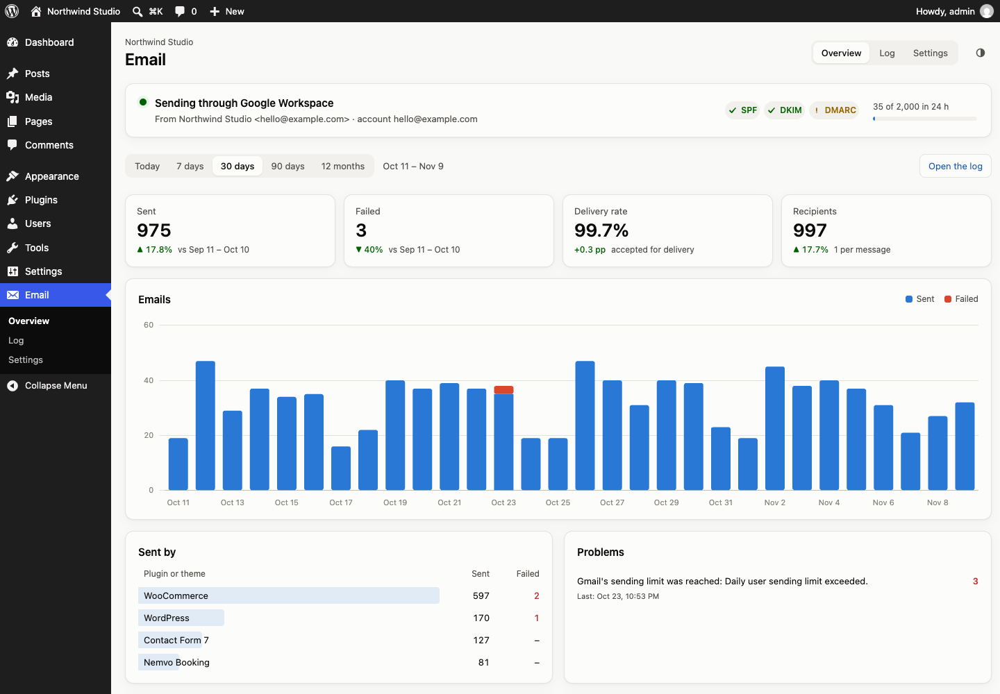
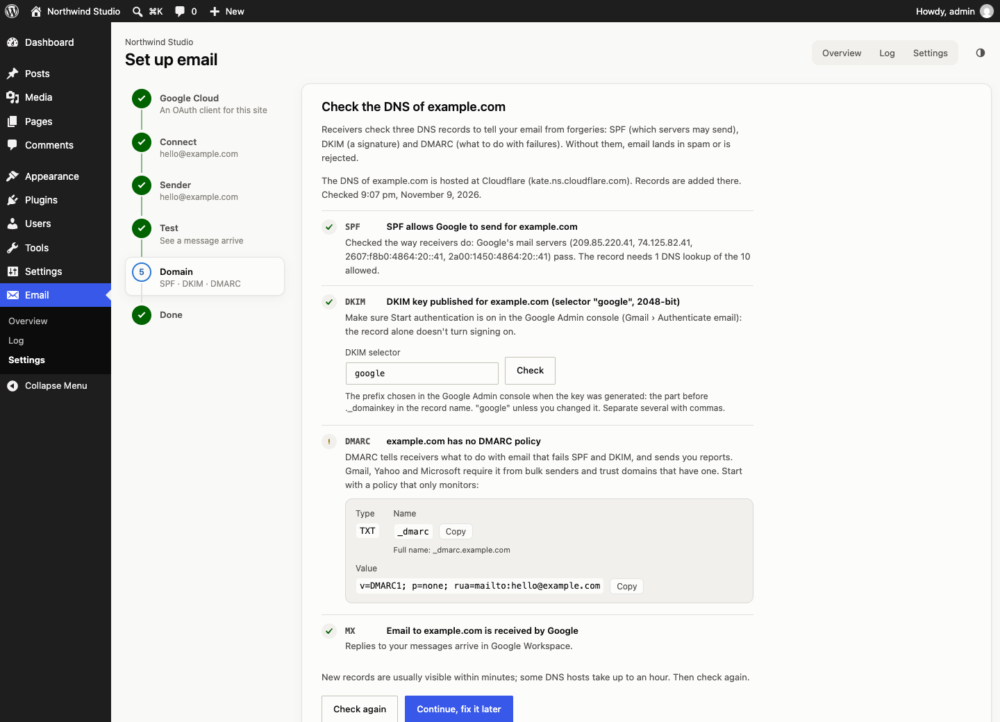

# Nemvo Email

Sends all WordPress email through Google Workspace or Gmail with OAuth and the Gmail API, instead of the web server. A guided setup, a delivery log with statistics, SPF, DKIM and DMARC checks, and import from WP Mail SMTP.



## What it does

- **Every `wp_mail()` message goes through Google.** WooCommerce, contact forms, WordPress itself: everything that uses `wp_mail()` keeps working, with all its filters, and leaves from Google's servers. Messages are uploaded to the Gmail API as PHPMailer built them (up to 35 MB), so headers, Cc, Bcc, attachments and inline images arrive untouched.
- **A guide through the setup.** Create the OAuth client in Google Cloud (direct links, the redirect URI to copy, Internal vs External explained), sign in with Google, pick the sender, send a test email, check the domain. Each step says what to do when Google shows an error.
- **Import from WP Mail SMTP.** Its sender settings, "Do not send" and its Gmail mailer's OAuth client and connection are imported, so a site that already sends through Gmail switches in one click.
- **A delivery log with statistics.** Every message with its recipients, subject, the plugin or theme that sent it, size, and Gmail's message id or the exact error. The overview charts sent and failed email, the delivery rate, which plugins send, the most common types of email (subjects with their numbers grouped), recipient domains and problems; every row opens the matching messages in the log. Optionally keep message content to read it in a sandbox and resend it.
- **SPF, DKIM and DMARC, explained.** Checks the sender domain for Google and says exactly what to publish, with copy buttons. SPF is evaluated like a receiving server does (RFC 7208: `include:`, `redirect=`, `a`, `mx`, `exists`, macros, the 10-lookup limit) for Google's real mail servers over IPv4 and IPv6, so flattened and hosted records are judged right; records served by DMARC Manager (`dspf.app`) count as fine, with a note that they can't be fully checked. DKIM is checked at the selector(s) you set on the DKIM line, with common selectors suggested when there is no key. DMARC says whether email will actually pass, strict alignment included. It names the DNS host (Cloudflare, deSEC, Route 53, …) and runs again every day.
- **Says when it breaks.** A revoked authorization, a disabled Gmail API or a missing permission shows on every admin screen and in Site Health, with what to do. A daily check finds it before an important email fails.
- **Minimal.** Only the `gmail.send` permission (it can't read email), your own OAuth client, no tracking, no templates.



## Requirements

WordPress 6.2 or later, PHP 7.4 or later, and a Google Workspace or Gmail account with access to Google Cloud. Google requires the site to be on https:// (or localhost) for the sign-in.

## Install

Download `nemvo-email-x.y.z.zip` from [Releases](https://github.com/fpoller/nemvo-email/releases) and upload it under **Plugins › Add New › Upload Plugin**. Then open **Email › Set up**. Until an account is connected, WordPress sends email as before, and the log already shows it.

## How it works

```
wp_mail()  ── filters, headers, attachments, phpmailer_init: all as usual
   │  pre_wp_mail (last): the global $phpmailer becomes NemvoEmail\Message
   ▼
Message::send() ─► Mailer::send()
   │   sender rules: other senders replaced (Gmail can't send as them), outside ones become Reply-To
   │   PHPMailer builds the MIME message: CRLF, To, Cc, Bcc, Subject in the headers
   ▼
Providers\Google::send()
   │   access token (refreshed with the encrypted refresh token when expired)
   │   POST gmail.googleapis.com/upload/gmail/v1/users/me/messages/send?uploadType=media
   │   401 → refresh and retry once · 429/5xx → retry once · 403 API off/permission → connection marked broken
   ▼
Log::insert()  ── sent / failed / paused, with the plugin that called wp_mail()
```

- **Without a connection** the plugin steps aside: WordPress sends as usual (PHP mail, or SMTP set up by another plugin in `phpmailer_init`) and the result is logged. Another plugin's own PHPMailer (WP Mail SMTP's) is only replaced once an account is connected here.
- **Providers** implement `NemvoEmail\Providers\Provider` (send a MIME message, OAuth connect and callback, check, DNS needs, limits). Google Workspace is the only one in 1.0.0; Microsoft 365 or others can be added as classes next to it.
- **Secrets** (refresh and access tokens, the client secret) are encrypted with XSalsa20-Poly1305; the key is derived from the WordPress salts or `NEMVO_EMAIL_KEY`. OAuth uses a signed, user-bound, single-use state and PKCE.
- **The log** is `{prefix}nemvo_email_log`. Statistics are counted from it, by the site's local time. Entries older than the retention (90 days by default) are deleted daily.

## Configuration

Everything is on **Email › Settings**. These can also come from wp-config.php constants or environment variables (with `_FILE` variants for Docker secrets):

| Variable | Purpose |
|---|---|
| `NEMVO_EMAIL_GOOGLE_CLIENT_ID`, `NEMVO_EMAIL_GOOGLE_CLIENT_SECRET` | The OAuth client, instead of the settings screen |
| `NEMVO_EMAIL_KEY` | Key for encrypting tokens, instead of the WordPress salts |
| `NEMVO_EMAIL_PAUSE` | `true`: log email but don't send it (staging copies of a live site) |

| Hook | Purpose |
|---|---|
| `nemvo_email_sent`, `nemvo_email_failed`, `nemvo_email_paused` (actions) | After each message: the PHPMailer object, the result (message id or error) and the provider |
| `nemvo_email_log_entry` (filter) | Change a log entry, or return `false` to leave a message out of the log |
| `nemvo_email_capability` (filter) | Capability for the screens and the REST API (default `manage_options`) |

## WP-CLI

```sh
wp nemvo-email status                   # connection, sender, DNS and warnings
wp nemvo-email test you@example.com     # send a test email
wp nemvo-email dns [example.com] [--selector=google2026]   # check SPF, DKIM, DMARC and MX
wp nemvo-email log --status=failed      # recent messages
wp nemvo-email import                   # import WP Mail SMTP's settings and connection
wp nemvo-email purge --days=30          # delete log entries older than 30 days
wp nemvo-email seed --days=90 --reset   # made-up history, test sites only
```

## Development

The dev container (`.devcontainer/`) runs WordPress, MariaDB and Mailpit. By default Google is simulated (`NEMVO_EMAIL_GOOGLE_MOCK=1`): "Sign in with Google" skips the consent screen, and messages sent through the fake Gmail API are delivered to Mailpit over SMTP exactly as uploaded (minus Bcc, like Gmail). `setup.sh` installs WordPress, connects the fake account `hello@example.com` and seeds 90 days of history. DNS for `example.com` is made up too.

```sh
docker compose -f .devcontainer/docker-compose.yml up -d
docker compose -f .devcontainer/docker-compose.yml exec wordpress bash /workspace/.devcontainer/setup.sh
```

| | |
|---|---|
| WordPress | http://localhost:8060 (admin / admin) |
| Mailpit | http://localhost:8065 |

To try a real Google account, start the stack with `NEMVO_EMAIL_GOOGLE_MOCK=0` and create an OAuth client with the redirect URI `http://localhost:8060/wp-admin/admin-post.php?action=nemvo_email_oauth` (Google accepts http for localhost).

### Tests

```sh
dc="docker compose -f .devcontainer/docker-compose.yml exec -T wordpress"
$dc wp eval-file /workspace/tests/mail-test.php   # 215 checks: wp_mail() takeover, MIME, OAuth, tokens, retries,
                                                  # sender rules, log, statistics, REST, DNS, WP Mail SMTP import, Site Health
cd tests/e2e && npm install && npm test           # real Chrome: the whole setup guide, Mailpit delivery, overview, log,
                                                  # resend, broken connection, import, dark mode, phone width
node tests/e2e/assets.mjs                         # regenerate .wordpress-org/ screenshots, icons and banners
```

The PHP tests use an empty log table of their own and fakes for Google and DNS that record every request; the browser test restores the dev site's settings afterwards.

### Build and release

```sh
./build.sh                                   # dist/nemvo-email-<version>.zip
./smoke-test.sh dist/nemvo-email-1.0.0.zip   # clean WordPress: screens, logging, REST, sending, uninstall,
                                             # Plugin Check (no errors or warnings), PHP 7.4 lint
```

CI runs PHP 7.4–8.4 lint, WordPress Coding Standards (with PHPCompatibilityWP), the build and Plugin Check. See [PUBLISHING.md](PUBLISHING.md) for releases and WordPress.org.

## Changelog

### 1.0.1

- SPF is evaluated the way receiving servers do, for Google's mail servers over IPv4 and IPv6: flattened records, `redirect=` and macros are judged correctly, and IPv4-only coverage gets a warning.
- SPF records served by DMARC Manager (`dspf.app`) show as fine, with a note that they can't be fully checked.
- The DKIM selector (or several) is set on the DKIM line, in the setup guide and the settings; common selectors with a key are suggested.
- DMARC's strict alignment (`aspf=s`, `adkim=s`) is taken into account.
- Checking another domain no longer replaces the sending domain's result.

### 1.0.0

First release: all WordPress email through Google Workspace or Gmail with the Gmail API and OAuth, a setup guide, a delivery log with statistics, SPF, DKIM and DMARC checks, import from WP Mail SMTP, Site Health checks and WP-CLI commands.

## License

[MIT](nemvo-email/LICENSE). Chart.js is bundled unmodified (MIT), see [`assets/vendor/README.txt`](nemvo-email/assets/vendor/README.txt).
